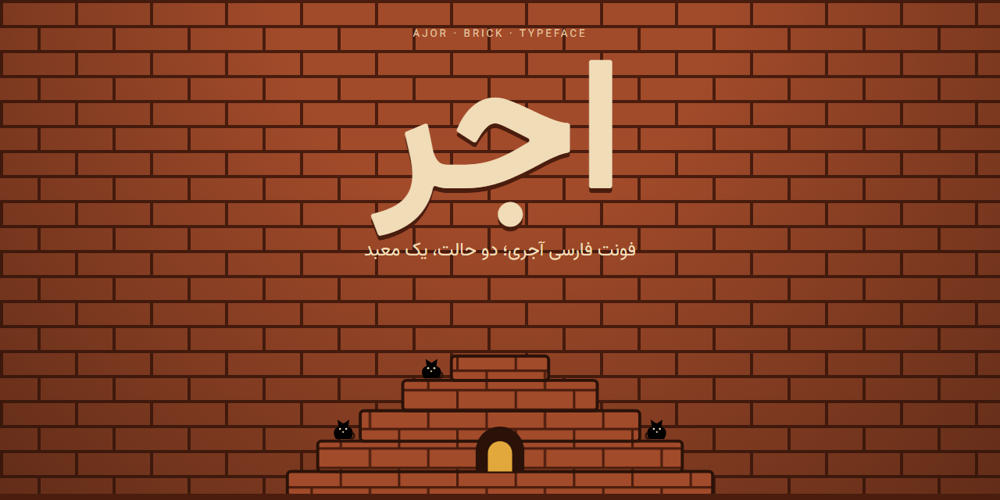

<p align="center"></p>

# اجر · Ajor

فونت فارسی متن‌باز با دو حالت (نه دو وزن؛ دو شخصیت)، الهام‌گرفته از آجر و معبد باستانی.
Open-source Persian typeface with two personalities, inspired by bricks and ancient temples.

| Family | Style |
|---|---|
| **Ajor** | formal, rounded corners, diamond dots |
| **Ajor Fancy** | round dots, joined dots, round sarkesh, two hamzas in a row (ءء) become a cat |

Each family has nine weights (Thin to Black); Regular and Bold are used by the site. Both add `U+E000` (cat face) and `U+E001` (paw).

**Site:** https://nikan48g.github.io/ajor/ · **Fonts:** [`fonts/`](fonts) (TTF + WOFF2)

## Build
```
pip install fonttools shapely brotli
git clone --depth 1 https://github.com/dastyar-io/dastkhat-font _ref
python src/build.py
```
Ajor is derived from [Dastkhat](https://github.com/dastyar-io/dastkhat-font) (Diamond and BarDots), itself derived from [Vazirmatn](https://github.com/rastikerdar/vazirmatn). Licensed under SIL OFL 1.1 (see [OFL.txt](OFL.txt)).
